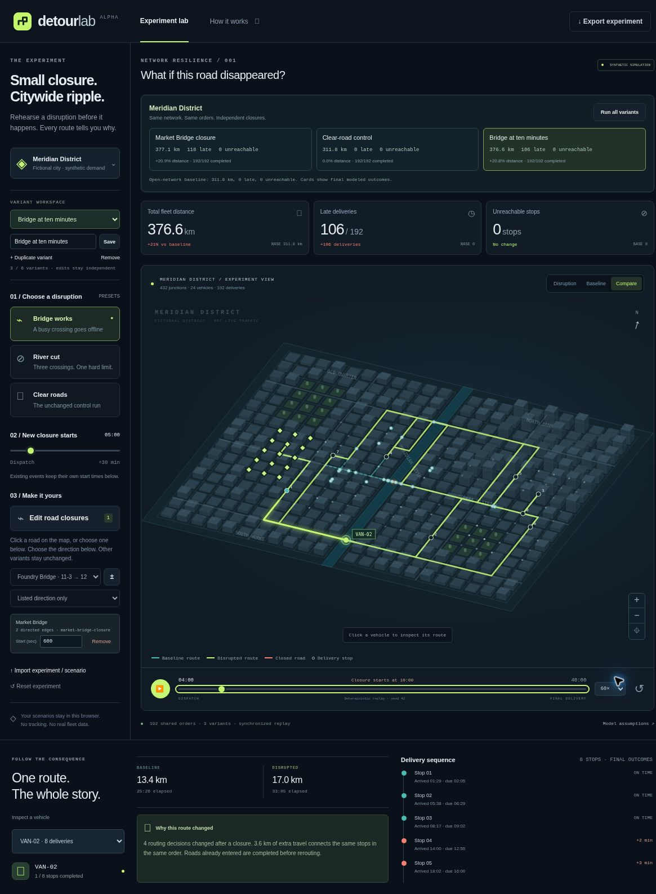
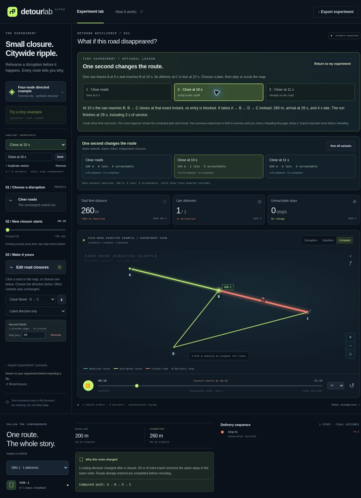

# DetourLab

**Close a road. Keep the same orders. See what changes.**

[Open the live demo](https://detourlab-tabish.tabisharaza.chatgpt.site/) · [Release verification](docs/PUBLICATION.md) · [Quickstart](#run-locally) · [Experiment format](docs/EXPERIMENTS.md) · [Contribute](CONTRIBUTING.md)

DetourLab is a browser-based logistics disruption lab. Create named closure variants over one shared street network and delivery plan, replay the fleet, and compare distance, late arrivals and unreachable stops. Export the experiment as JSON and reproduce every result from the command line.

The bundled city, fleet and demand are entirely synthetic. The app needs no API key, account, map service or npm dependency.

Use the native controls by keyboard, including the road and direction selectors. The [searchable road picker](docs/ROAD_PICKER.md) adds a text filter and selected-road context without replacing the native select. [Keyboard controls and modal focus](docs/KEYBOARD.md) describes the guide, lesson confirmation, focus return and verification limits.



*An actual capture of the public v5 workbench on October 10, 2026 UTC. The ten-minute closure variant was created in the interface. [Screenshot provenance](docs/VERIFICATION.md#screenshot).*

Compare individual delivery regressions in CI with the [opt-in job gates](docs/JOB_GATES.md): newly late deliveries and worst comparable arrival slip, including explicit missing-evidence failures.

## Try one experiment

**New here? Start with four junctions.** Use **Try a tiny example** in the app for a one-van lesson you can trace by hand. Three plans share the same job: clear roads, a closure at 10 seconds, and the same closure at 11 seconds. The optional lesson keeps your current experiment in memory so you can return to it; reload still clears unsaved work.

The [tiny experiment walkthrough](docs/EXPERIMENTS.md#tiny-walkthrough-one-second-changes-the-route) explains why the 10-second closure produces a 260 m route and a late arrival at 26 seconds, while the other plans travel 200 m and arrive at 20 seconds. No import or API key is needed to try it in the app. For the same example in Node:

```sh
node scripts/run-experiment.js examples/minimal-experiment.json --json
```



*Actual public v6 capture, October 10, 2026 UTC. [Lesson verification and screenshot provenance](docs/VERIFICATION.md#v6-tiny-lesson-deployment-and-desktop-checks).*

For the larger fictional district:

1. Open the [demo](https://detourlab-tabish.tabisharaza.chatgpt.site/). The initial plans are **Market Bridge closure** and **Clear-road control**.
2. Duplicate the bridge plan and name it **Bridge at ten minutes**.
3. Change that variant's closure event from **300** to **600** seconds. Other variants keep their schedules.
4. Compare the final outcome cards. Select any plan to inspect its route at the same replay time.
5. Export the experiment and run it in Node.

In the bundled seed-42 experiment, the five-minute bridge closure produces **118 late arrivals**; moving its start to ten minutes produces **106**. Those are model results from the same 192 orders, not measured delivery performance.

## Find a road before editing

The demo adds **Find a road** above the existing **Road segment** selector. Search by road name, full junction ID or representative edge ID, then choose the road, direction and cutoff for the selected variant. The context text describes that variant's saved closure schedule; it does not describe closure state at the current replay time.

Search only filters the choices. It does not edit the experiment or launch a calculation. A still-matching selection is retained; otherwise the first match is selected. No matches disables the road edit action, and **Clear search** restores all choices. Ordinary edits and variant changes keep the search; entering the tiny lesson starts fresh, and returning restores the previous search and selection.

The default district has **807 road-pair choices**. [Road-picker behavior and verification limits](docs/ROAD_PICKER.md) explain exact matching, direction semantics and the separate browser-review status. The v9 browser review found a run-lifecycle focus issue; its v10 correction passed native cancellation and completion retests.


*Actual public v10 capture, October 19, 2026 at approximately 08:47 UTC, in desktop Chromium on Linux at 100% zoom. [Screenshot provenance and bounded browser evidence](docs/VERIFICATION.md#v10-native-focus-checks-and-screenshot).*

## Run locally

From the downloaded source or repository checkout:

```sh
node --version       # Node >=24.2.0; locally tested baseline is in .node-version
npm start
# Open http://127.0.0.1:4173
```

There is nothing to install. Node serves the static app on loopback only. Use the server instead of opening `index.html` directly: browser module workers need an HTTP origin.

```sh
npm run check        # Syntax checks, automated tests and static build
npm run build        # dist/ plus a SHA-256 file manifest
npm start -- --dist  # Preview the built distribution
npm run benchmark    # Named-machine timing of the original paired fixture
```

The app and its core checks have zero npm dependencies. An optional, separately locked schema/editor checker lives under `tools/schema-check`; it is not needed to run the app. The root lockfile is included. CI validates it with `npm ci --ignore-scripts --no-audit --no-fund`; this is optional for local use. Node 24.2.0 is the API floor for the release verifier, not a tested-minimum claim. Local checks used Node 24.19.0. [The initial public release passed hosted CI](https://github.com/Tabisharaza/detourlab/actions/runs/37995893928) on Node 24.19.0 and 24.21.0; the latter is additional verified coverage, not a required installed version. See [CI and reproducibility](docs/CI.md).

## Reproduce all variants

The bundled [Meridian experiment](examples/meridian-experiment.json) contains four plans:

| Plan | Distance | Late | Unreachable | Completed |
| --- | ---: | ---: | ---: | ---: |
| Open-network baseline | 311.80 km | 0 | 0 | 192 |
| Market Bridge at 05:00 | 377.08 km | 118 | 0 | 192 |
| Market Bridge at 10:00 | 376.60 km | 106 | 0 | 192 |
| All bridges at 05:00 | 145.68 km | 0 | 57 | 135 |
| Clear-road control | 311.80 km | 0 | 0 | 192 |

The all-bridges plan travels less because it skips unreachable work. Read completed and unreachable counts alongside distance and lateness.

```sh
npm run experiment -- examples/meridian-experiment.json --json
npm run experiment -- examples/meridian-experiment.json \
  --max-extra-distance-pct 30 --max-extra-late 150 --max-unreachable 60
```

Thresholds apply independently to every variant. The report includes a deterministic experiment fingerprint and names any failing variant. Exit codes: `0` for a completed run within the supplied thresholds, `1` for a threshold failure (including a requested arrival-slip gate with no comparable jobs), `2` for invalid input or a failed simulation. No threshold flags means no numeric acceptance limits were requested.

For an exported file, use the direct runner when capturing machine-readable output (npm itself prints an additional script header):

```sh
node scripts/run-experiment.js your-experiment.json --json > results.json
```

The original single-scenario runner remains available:

```sh
npm run scenario -- examples/meridian-default.json --json
```

## Share a complete review

```sh
node scripts/report-experiment.js examples/minimal-experiment.json \
  --out tiny-review --max-arrival-slip-s 6 --max-unreachable 0
```

[Read the generated tiny review](docs/examples/tiny-review/REVIEW.md) or inspect its [complete machine bundle](docs/examples/tiny-review/bundle.json). Both are reproduced byte-for-byte by a source test.

The [review packet](docs/REVIEW_PACKETS.md) puts the validated experiment, supplied acceptance limits, every variant’s results and complete delivery outcomes in `bundle.json`, alongside a readable `REVIEW.md`. It runs the simulation once. Use a fresh output directory; a failing policy still produces the packet and exits 1. With no limits, acceptance is explicitly not evaluated.

## Author a portable input

Use a filename ending in `.scenario.json` or `.experiment.json` inside this checkout to get scoped JSON Schema diagnostics, completion and unit-rich hover help in VS Code. The [authoring guide](docs/JSON_SCHEMAS.md) includes small valid examples and explains the checks that still require the runtime. Do not add `$schema` to your data files: the import format remains strict.

The two original Draft-07 schemas share definitions, resolve locally and describe the existing v1 formats. The separately pinned [optional checker](tools/schema-check/package.json) tests structural acceptance and the JSON language service; app startup remains dependency-free.

## Inspect which deliveries changed

```sh
node scripts/explain-experiment.js examples/meridian-experiment.json --variant market-05
node scripts/explain-experiment.js examples/minimal-experiment.json --variant close-at-10 --json
```

The [job-impact report](docs/JOB_IMPACT.md) compares each delivery’s status, arrival, service completion and lateness with the clear-road baseline. In Meridian, 125 arrivals change but only 118 jobs become late; seven deliveries arrive later while still meeting their deadlines. Unreachable timings remain explicit nulls.

The human view shows the first 20 changed jobs and says how many are omitted; versioned JSON includes all jobs and the input fingerprint. It uses the same bounded simulation as the threshold runner and does not infer per-job routes or complete closure causality.

## What is here

- 432 junctions, 1,614 directed edges, 24 vehicles and 192 seeded jobs in the default district
- Two to six named variants sharing identical geometry, fleet, demand and job order
- Independent closure events with explicit cutoffs and direction-aware road edits
- Road filtering by name or ID, with saved-schedule context and native controls
- Actual simulation ledgers driving the map, route inspector and final-run KPIs
- A selected vehicle's baseline/disrupted overlay, shared replay time, pause, speed and zoom
- Cancel/rerun, terminated superseded workers and stale-result/import guards
- Bounded experiment JSON, backward-compatible scenario imports and deterministic CLI thresholds
- Headless per-job impact reports with complete status transitions and comparable timing differences
- Portable all-variant review packets with embedded input, policy and readable exceptions
- Original procedural geometry, a buildless UI, a module Worker and Node-native tests

## Model assumptions

- Directed edges have fixed assumed distances and travel times. Vehicles do not create congestion or interact physically.
- Vehicles retain their assigned stops and delivery order. Routes minimize travel time, then distance, with stable tie-breaking.
- Closures are permanent. Entry at the cutoff is blocked; a vehicle already on that edge finishes before rerouting.
- An unreachable job is recorded and skipped. Traveled distance is retained, and the next job is attempted from the current location and time.
- Due times are **arrival deadlines**. Service time delays the next leg.
- The playback horizon extends to finish the work; it does not silently truncate a run.
- Capacity, reassignment, optimal vehicle routing, driver breaks, traffic signals, collisions and return-to-depot policy are outside this model.

This alpha is for reproducible network experiments. It has not been validated for operational decisions or real-world traffic forecasting. See [architecture](docs/ARCHITECTURE.md), [design decisions](docs/DESIGN.md), and [known gaps](docs/VERIFICATION.md).

## Privacy, limits and licenses

Imported files are parsed in browser memory. The app sends no scenario data, analytics, external font requests or map-service calls. Export is a user-initiated local download. Reloading clears unsaved work. A hosting provider may still process ordinary web-request metadata.

Source file entry points reject malformed UTF-8 and limit inputs to 2 MiB, with strict fields, foreign-key checks, finite numeric bounds and prototype/accessor rejection. All three CLI entry points use bounded regular-file reads; [the file-input guide](docs/FILE_INPUT.md) explains encoding, safe errors and reproducible roundtrip tests. Engine and experiment work budgets fail explicitly. The browser terminates a whole-experiment calculation after 30 seconds. These limits reduce resource-exhaustion risk; they do not establish an unlimited-input or security guarantee. See [SECURITY.md](SECURITY.md) and the [format limits](docs/EXPERIMENTS.md).

Application code, procedural geometry and fixtures use the [MIT license](LICENSE). No third-party map data is bundled. Future real city packs need separate provenance and data-license handling. See [attribution](THIRD_PARTY_NOTICES.md).

## Contribute

Start with a small reproducible scenario or an improvement that makes results easier to inspect. [CONTRIBUTING.md](CONTRIBUTING.md) explains the checks, [the roadmap](docs/ROADMAP.md) separates current and future work, and [open contribution issues](https://github.com/Tabisharaza/detourlab/issues) offer concrete scopes and acceptance tests. [Additional draft scopes](docs/ISSUE_DRAFTS.md) distinguish published work from proposals.

[A/B Street](https://github.com/a-b-street/abstreet), [Eclipse SUMO](https://github.com/eclipse-sumo/sumo), [VROOM](https://github.com/VROOM-Project/vroom), and [kepler.gl](https://github.com/keplergl/kepler.gl) address adjacent planning, simulation, optimization and visualization problems. DetourLab focuses on a small, inspectable disruption experiment and a portable regression fixture. Their code and datasets are not included here.

**Status:** early synthetic workbench. The public demo is **v10**, with searchable road editing and a run-lifecycle focus correction. [The v9 desktop Chromium review](docs/VERIFICATION.md#v9-road-picker-deployment-and-bounded-desktop-checks) exposed lost focus when Cancel run disappeared; the corrected source passes **601 core + 120 optional tests = 721 distinct tests**, including 29 road-picker and nine lifecycle-focus regressions. The 113 CLI repeats are already included. The [v10 cancellation/completion retest and served-manifest check passed](docs/VERIFICATION.md#v10-native-focus-checks-and-screenshot). Public GitHub source identity and exact-commit CI remain pending. Native file-picker/download roundtrips, mobile, reduced motion, screen readers and broader browser/performance checks remain open. See [the source evidence](docs/VERIFICATION.md#road-picker-and-run-lifecycle-focus-milestone). No adoption, production-readiness or Trending claim is made.

### Renderer update and live demo

The current source skips unchanged paused Canvas paints while preserving playback redraws. [Reproducible operation counts and limitations](docs/RENDERING.md) document the change. The guard first shipped in v5. The v7 demo included the v6 reversible tiny lesson and added [modal keyboard focus fixes from source `fb08b57`](https://github.com/Tabisharaza/detourlab/commit/fb08b57457eb70abe107eca0cab41f6f3d30261f). Its [CI run](https://github.com/Tabisharaza/detourlab/actions/runs/38042346894) passed **231 tests per Node job**. Both dialogs were exercised with real desktop keyboard input, including boundary navigation and focus return. [Deployment and browser evidence](docs/VERIFICATION.md#v7-modal-keyboard-deployment-and-desktop-checks) retains the exact source mapping and remaining QA gaps. Browser rendering time remains unmeasured. The October 11 [v8 deployment](docs/VERIFICATION.md#v8-source-parity-deployment) included the tested import and dynamic-focus source. The [v9 road-picker deployment and bounded desktop checks](docs/VERIFICATION.md#v9-road-picker-deployment-and-bounded-desktop-checks) are separate from that historical record. The public demo is now **v10**, with [the run-lifecycle focus correction deployed](docs/VERIFICATION.md#v10-run-lifecycle-focus-deployment); its native cancellation/completion retest passed. The served manifest matches the verified local build; individual remote assets were not independently downloaded and hashed.

### File-input source update

The current source rejects malformed UTF-8 consistently, bounds all three CLI reads and makes hostile file errors short and safe to display. The [deterministic regression corpus](docs/FILE_INPUT.md) covers 48 experiments and 189 variants. [Hosted CI for `e9285ee`](https://github.com/Tabisharaza/detourlab/actions/runs/38055582446) passed 341 tests on both pinned Node versions; [the verification record](docs/VERIFICATION.md#file-input-source-milestone) records the exact scope. These fixes first deployed in v8. The native file-picker QA gap remains open.

### Dynamic editor keyboard update

The current source keeps comparison cards and closure-editor controls in place while their data changes, so repeated keyboard edits do not discard the active control. Deleted controls and variant-limit buttons get a nearby usable focus target. [Hosted CI for `0559eec`](https://github.com/Tabisharaza/detourlab/actions/runs/38069928417) passed **357 tests on both pinned Node versions**, including 16 new regressions; [keyboard behavior and remaining checks](docs/KEYBOARD.md) are documented separately. This source change first deployed in v8; wider native Tab/blur coverage remains separate from the specific v9 observations.
