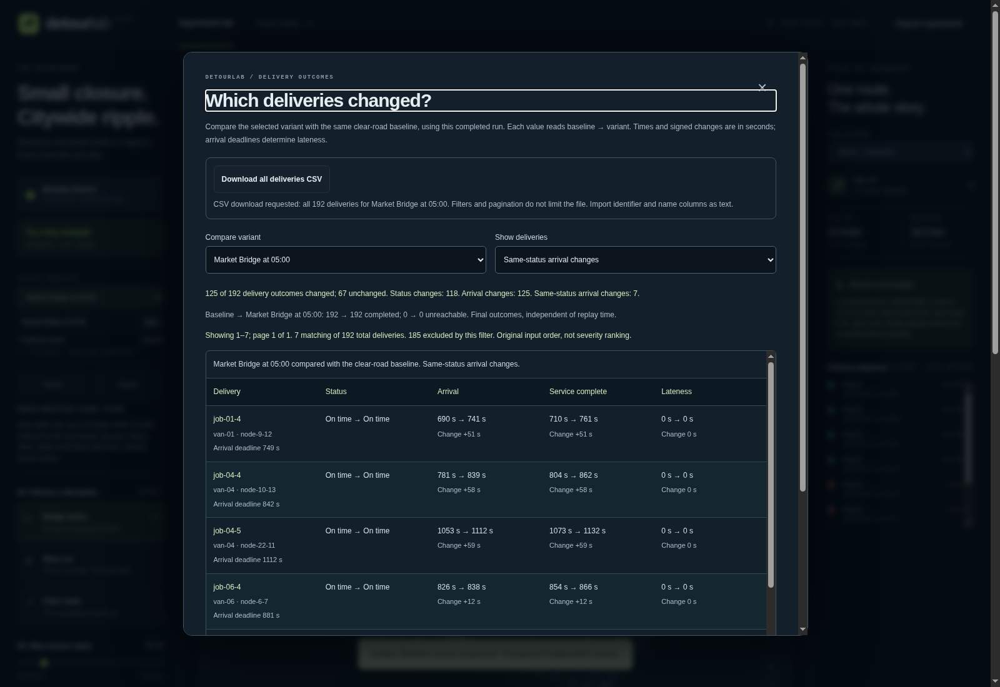
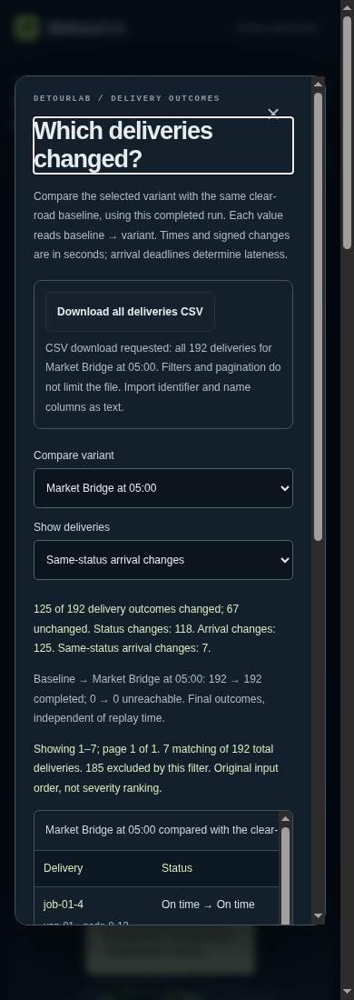

# Take delivery comparisons into a spreadsheet

Export the complete delivery comparison for one selected plan without copying
screen pages or treating unreachable work as zero delay. This is a presentation
format for reviewing synthetic outcomes, not an experiment import format,
acceptance verdict or operational recommendation.

## Quick start

```sh
node scripts/explain-experiment.js examples/minimal-experiment.json --variant close-at-10 --csv > delivery-impact.csv
```

In the source workbench, finish a run, open **Inspect deliveries**, choose a
variant and press **Download all deliveries CSV**. The fixed filename is
`detourlab-delivery-impact.csv`. The file includes every job in original input
order, even when the screen shows only changed outcomes or a later page. A
zero-job experiment exports just the column header.

The browser uses the same serializer as the CLI and reuses completed Worker
results. Export does not rerun the simulation, alter the experiment, create an
account or contact a service. A changed input/run, Undo, Reset, successful import,
Close or Escape prevents the old comparison from being downloaded. Reopen after
a completed run to export current results.

For the tiny example the only job arrives at 20 seconds in the baseline and 26
in `close-at-10`, a +6 second shift. Its service completes at 23 and 29 seconds.
It changes from `on-time` to `late`, with lateness moving from 0 to 4 seconds.
The checked-in [tiny CSV](examples/tiny-delivery-impact.csv) is actual CLI output.

## Columns and numeric meaning

The header contains these 20 fields in fixed order:

1. `experimentId`, `variantId`, `variantName`
2. `jobId`, `vehicleId`, `nodeId`, `dueTimeS`
3. `baselineStatus`, `baselineArrivalS`, `baselineCompletedS`, `baselineDelayS`
4. `variantStatus`, `variantArrivalS`, `variantCompletedS`, `variantDelayS`
5. `arrivalDeltaS`, `completedDeltaS`, `delayDeltaS`, `changed`, `statusChanged`

All times and deltas are seconds. Deltas are variant minus baseline without
rounding. Zero remains `0`, never an empty cell. Missing timings and incomparable
deltas are empty cells; `unreachable` explicitly identifies skipped work. Never
fill those empty cells with zero when comparing plans. A negative delta means an
earlier comparable time in this fixed-order model, not a better overall plan.
Boolean flags are `true`/`false`; unchanged rows remain in the file.

The format is UTF-8 without a BOM, comma-delimited, with CRLF records and a final
CRLF. Fields containing commas, quotes or line endings are quoted and internal
quotes doubled. Quoted multiline labels are one field, not extra jobs. Programs
must use a CSV parser, not split records on newline. Numbers retain JavaScript's
finite-number text representation, including scientific notation when needed.

The output includes no local path or execution timestamp and is repeatable for
the same completed input. It does not contain simulation ledgers, source hashes
or proof of authorship. Use [review packets](REVIEW_PACKETS.md) and their verifier
for complete reproducible evidence, or `--json` for raw machine values.

## Spreadsheet text precautions

**Import identifier and name columns as text**, rather than relying on automatic
spreadsheet type guessing. This also preserves numeric-looking identifiers and
avoids scientific/date conversion. Keep calculations in numeric timing columns.

The exporter applies conservative display transformations to text fields:

- Literal backslashes are doubled.
- Unicode control/format characters other than CR/LF appear as literal
  `\u{hex}` escapes. CR/LF remain inside correctly quoted fields.
- For detection only, text is compatibility-normalized and leading whitespace,
  control and format characters are ignored. If the first remaining character
  is `=`, `+`, `-`, `@` or apostrophe, an apostrophe is prepended to the exported
  display value. This includes compatible full-width forms. Original text is
  not otherwise Unicode-normalized.

These transformations mitigate common formula interpretation; they are **not a
guarantee for every spreadsheet or import setting**. An apostrophe may be shown
literally by some importers. Do not remove protections and then automatically
execute imported expressions. Raw JSON remains unchanged and is the right
choice when exact original text matters. Numeric values are separately validated
finite numbers, not user-provided formula text.

## Bounds and verification

The serializer requires a complete report with matching row count, unique job
IDs, known statuses, consistent nulls/deltas/change flags and at most 2,000 jobs.
It validates and constructs the complete output before returning any bytes;
UTF-8 output is capped at 4 MiB. No page-only fallback or truncated file is emitted.
The CLI still validates and simulates the whole experiment under existing work
budgets. `--csv` and `--json` are mutually exclusive; failures exit 2 with no
report on stdout. Exit 0 means output produced, not a passed acceptance policy.

```sh
node --test tests/job-impact-csv.test.js tests/job-impact-csv-cli.test.js tests/impact-csv-app.test.js
npm run check
node scripts/verify-dist.js
```

The optional native download harness uses a fresh local Chromium profile:

```sh
node tools/impact-csv-check/run.js --browser /absolute/path/to/chromium --out /new/evidence-directory
```

It compares actual downloaded bytes with independently invoked CLI output,
checks full rows despite filters/pages, changed variants, stale callbacks and
native keyboard activation, and retains raw desktop/narrow captures. This is
not native OS save-dialog, spreadsheet-product, assistive-technology, physical
mobile-device or cross-browser certification. Hosted deployment is separate.

## Product context

The November 6 read of the requested [God's Eye View reference](https://github.com/bilawalsidhu/gods-eye-view)
reinforces making an interactive scene inspectable. DetourLab's distinct product
need here is taking a complete synthetic delivery comparison into an existing
review workflow. No code, assets or data were copied, and no adoption or Trending
outcome is promised.

## Recorded source verification — November 6, 2026

[Source `cfaec03`](https://github.com/Tabisharaza/detourlab/commit/cfaec034b2d72ecbe168ae80ec042bd15aca0e44)
passed [CI run 42175073010](https://github.com/Tabisharaza/detourlab/actions/runs/42175073010).
The [raw CSV evidence](evidence/delivery-csv-2026-11-06.json) is extracted without
field changes from the job's printed JSON. All source and screenshot hashes were
checked against the tested bytes.

- 1,307 core Node tests plus 120 optional schema/editor tests passed: **1,427
  distinct tests**. The 211 repeated CLI checks overlap the core suite.
- All **16 new CSV checkpoints** passed, including **14 actual completed
  downloads** compared byte-for-byte with separate Node CLI processes. Enter and
  Space activations generated trusted browser click events.
- All **85 existing browser checkpoints** and **four rendering-profile cases**
  passed separately. They are not added to the Node test total.
- The 32-file release passed exact allowlist, source-byte, license and SHA-256
  checks. A second build reproduced every byte, including the manifest.

Review caught and corrected an incorrect filter expectation before publication.
The first source CI then caught incomplete character data in the new keyboard
test driver. It was fixed using the existing native-key helper and a regression
test, retaining strict real-download/trusted-event assertions. No product
keyboard handler was changed to accommodate the test.

The local browser could not launch because the execution environment denied its
OS socket. Native evidence is from hosted CI on Chromium 156.0.8078.79, not a
local pass. No browser security flags were weakened. Existing native chooser,
spreadsheet-product, physical device, screen-reader and cross-browser gaps remain.

The unaltered desktop and 390px CSS-viewport captures below were visually
inspected: the export action and complete-file/import-text guidance remain
readable without clipping. The narrow table retains its deliberate scroll
region. These are synthetic source captures, **not a hosted demo release**.




