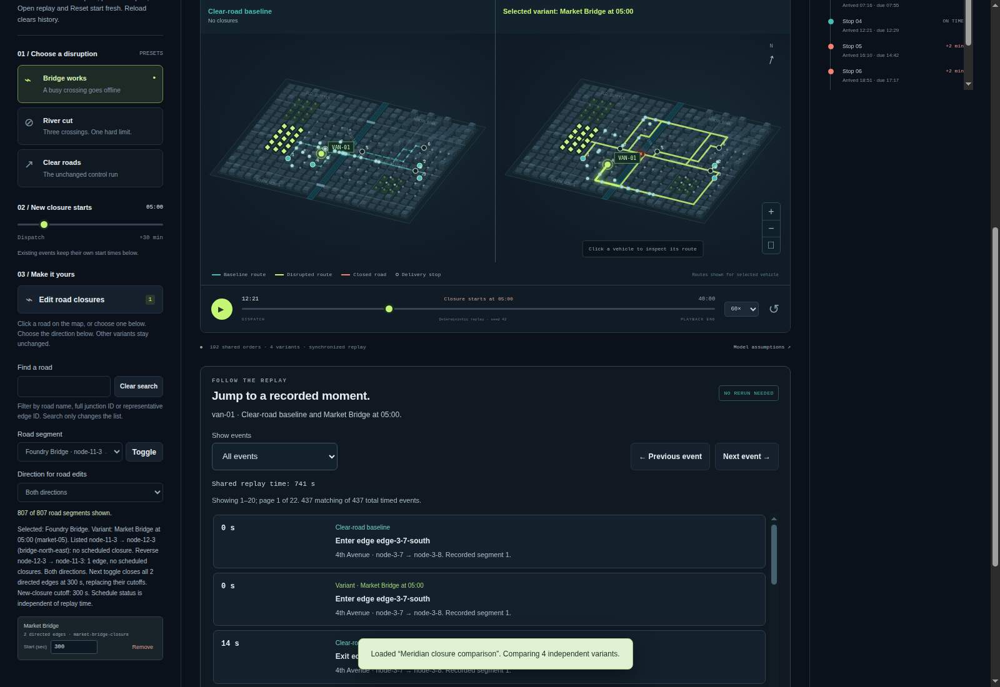
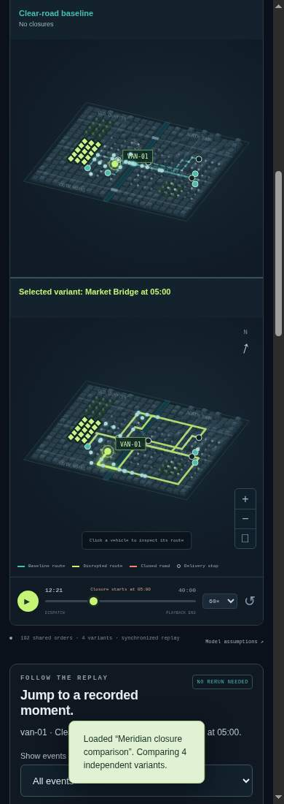

# Go from a delivery comparison to its replay

Find a changed delivery, then inspect its vehicle at the exact recorded arrival
without manually matching a vehicle and scrubbing the clock. The source
inspector connects its baseline and variant arrival evidence to the existing
synchronized maps. No simulation, route assignment or metric changes.

## Try it

1. Run the tiny example and select **Close at 10 s**.
2. Open **Inspect deliveries**. The job arrives at 20 seconds in the clear-road
   baseline and at 26 seconds in the variant.
3. Choose **Replay baseline arrival** or **Replay variant arrival** in its
   arrival cell. The inspector closes, selects that job's vehicle, pauses replay
   at the chosen timestamp and opens the two-map comparison.
4. Both panes show the **same absolute time**, not each vehicle at its own
   arrival time. Use the replay-event controls to inspect nearby recorded events
   or save the perspective with **Save replay**.

For a large experiment, use [delivery search and ordering](DELIVERY_SEARCH.md)
first. A button always uses the identified row and selected variant, not the
row's current position in a filter or sorted page. The full CSV contract is
unchanged and still ignores the screen's search, order and pagination.

## Exact times, explicit limits

Fractional arrival seconds and zero are valid replay targets. The existing
clock label and range input display whole seconds, but the replay state and
Canvas interpolation use the exact recorded number. The announcement retains
that number. A missing arrival is **Not reached**, not a jump to zero; the other
side can still be inspected when its arrival exists.

This selects a vehicle's existing route overlay and a point in the completed
ledger. It does not isolate a per-delivery path, infer which closure caused a
delay, or claim that unchanged outcomes mean unchanged routes. Both maps remain
synthetic; no operational recommendation or real-traffic validation is implied.

## Safe navigation

Navigation reuses the completed input and results. It pauses playback, supersedes
pending bookmark navigation and leaves experiment history, input, metrics and
Worker requests unchanged. The action intentionally switches to split view and
selects the job's vehicle. Focus returns to a useful replay control rather than
an element removed with the dialog.

Rows discarded by filtering, paging, search, ordering, variant changes, close or
reopen cannot navigate later. Edits, imports and reruns invalidate completed
evidence before an old action can affect the new workspace. Native dialog-close
events must not reclaim focus after newer navigation.

## Reproduce checks

```sh
node --test tests/delivery-replay-ui.test.js
npm run check
node scripts/verify-dist.js
```

The Node application tests execute real handlers with DOM/Worker stand-ins.
Native Chromium evidence and reviewed screenshots are recorded separately when
verified. These checks do not establish OS chooser, screen-reader, physical
mobile-device or cross-browser behavior. The public demo remains the separately
recorded v11 release; this milestone is source publication, not a deployment.

## Recorded source verification — November 8, 2026

[Source `da1bbb2`](https://github.com/Tabisharaza/detourlab/commit/da1bbb2e7de636ec93bf6a98c770a0d756931b9c)
passed [CI run 42456661120](https://github.com/Tabisharaza/detourlab/actions/runs/42456661120).
The [raw delivery-replay evidence](evidence/delivery-replay-2026-11-08.json) was
extracted without field changes from the job's printed JSON. Every recorded
source and screenshot hash matched the tested bytes.

- **1,459 distinct Node tests** passed: 1,339 core and 120 optional schema/editor
  tests. The repeated 211 CLI gates overlap the core suite.
- All **13 new Chromium checkpoints** passed. The tiny baseline/variant replay
  reached 20/26 seconds; the synthetic boundary fixture retained 26.25 seconds,
  genuine zero and absent arrival times. A native CDP Enter activation required
  a trusted browser click. Other selections/clicks used disclosed DOM events.
- Stale callbacks were explicitly invoked after search, ordering, variant
  changes, close/reopen, pagination and real Worker recomputation. They did not
  navigate. All successful jumps left Worker request counts unchanged.
- A searched/ranked `job-01-4` selected `van-01` and paused both native map states
  at 741 seconds. This is an outcome from synthetic fixed-order simulation,
  not a measured delivery or a causal routing explanation.
- All **116 earlier browser checkpoints** and **four rendering-profile cases**
  passed separately. The 32-file release passed exact allowlist, source-byte,
  SHA-256 and license checks; a second build reproduced every byte and manifest.

Review corrected two test-only issues before publication: a missing required
closure ID in an unreachable fixture and the pre-feature Tab-edge expectation.
The final fixtures assert successful import; focus checks include the added
arrival buttons. The production routing and simulation code did not change.

Native evidence used Chromium 156.0.8078.79, Node 24.22.1, Ubuntu 24.04 image
`20261101.360.1`. The local browser's socket restriction was not bypassed. This
is hosted CI evidence, not a local browser pass or hosted demo deployment.
Screen readers, OS choosers, physical mobile devices and other browsers remain
separate verification gaps.

The unaltered captures below were visually reviewed. Both maps show `van-01`
at the same 741-second time; the narrow layout stacks the maps without horizontal
page overflow. Captures include the transient import toast and only the visible
viewport, not the whole workbench. They do not certify every control at mobile
sizes or establish pixel equivalence of a historical release.




