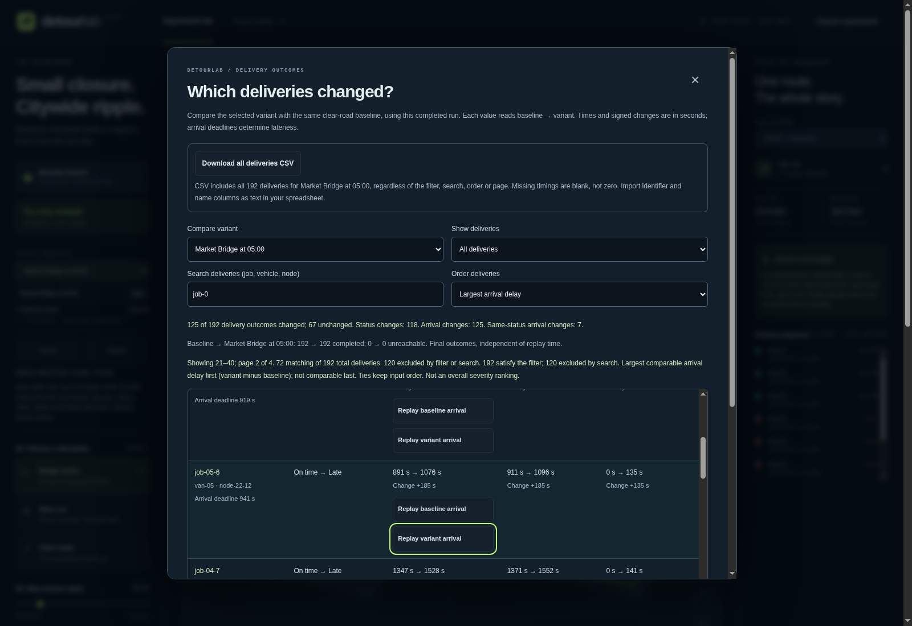
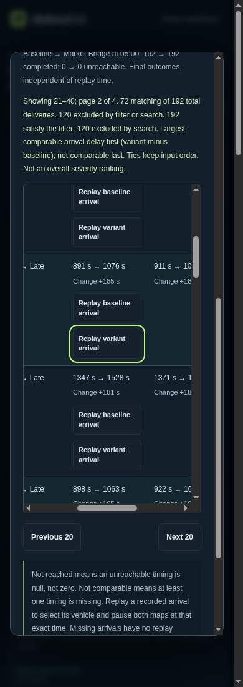

# Keep your place while inspecting a delivery

The source workbench now completes the delivery-review round trip. Search and
order a comparison, jump to an arrival on the maps, then return to the same
comparison page and delivery rather than starting your review again.

## Follow one delivery out and back

1. Finish a run and open **Inspect deliveries**. Choose a filter, search or order
   and move to the page you want.
2. Use a row's **Replay baseline arrival** or **Replay variant arrival** action.
   The maps pause at that recorded arrival and select the delivery's vehicle.
3. Explore the replay. Scrubbing, playback, map view, zoom and vehicle selection
   do not lose your comparison while its completed variant remains current.
4. Choose **Return to delivery comparison**. The inspector restores its filter,
   query, order and page, then focuses the arrival action you used.

Returning restores the **comparison view**, not the old replay perspective.
It pauses playback but keeps your current replay time, vehicle, map view and
zoom. No simulation is rerun and experiment edits/history remain unchanged.
The full CSV still includes every delivery in original input order.

## One bounded, temporary return point

Only the most recent arrival journey can be returned to. Successful return
consumes it; another arrival action creates a new one. The ordinary **Inspect
deliveries** button still starts a fresh comparison with its documented defaults
and discards the old return point.

The return point belongs to the exact completed input, results and variant.
Switching variants, changing input, importing a workspace, starting a new run,
resetting or entering/leaving a lesson invalidates it. Switching back does not
resurrect it. Old retained callbacks cannot reopen a newer or invalid comparison.
Nothing is saved to storage or uploaded, and reload clears this temporary state.

Missing arrival times remain unavailable for replay; they never gain a return
point at an invented zero time. Navigation still selects an existing vehicle
replay, not a per-delivery route or a closure-causation explanation. See
[arrival semantics and limits](DELIVERY_REPLAY.md).

## Reproduce verification

```sh
node --test tests/delivery-return-ui.test.js tests/delivery-replay-ui.test.js
npm run check
node scripts/verify-dist.js
```

Application tests use DOM and Worker stand-ins. Native Chromium checks and
reviewed captures are recorded separately when verified. Neither constitutes
screen-reader, native OS chooser, physical mobile-device or cross-browser
certification. The hosted demo remains v11; this is a source milestone, not a
deployment.

## Recorded source verification — November 9, 2026

[Source `d85abe5`](https://github.com/Tabisharaza/detourlab/commit/d85abe592a93e4e0e8ff5f50225e2937eb3b24f1)
passed [CI run 42573712595](https://github.com/Tabisharaza/detourlab/actions/runs/42573712595).
The [raw return evidence](evidence/delivery-return-2026-11-09.json) was extracted
without field changes from the job's printed JSON. All recorded source and
screenshot hashes matched the tested bytes.

- **1,477 distinct Node tests** passed: 1,357 core and 120 optional schema/editor
  tests. The repeated 211 CLI gates overlap the core suite.
- All **10 new Chromium checkpoints** passed, alongside **129 earlier browser
  checkpoints** and **four rendering-profile cases**.
- A `job-0` search in Meridian has 72 matching jobs. The check ordered them by
  arrival delay, navigated from `job-05-6` on page 2, changed the replay time to
  123 seconds and selected `van-02`, then returned to the same row and page.
  Comparison controls and counts were restored without rewinding the replay or
  adding Worker requests.
- Enter and Space generated trusted return-button clicks. Consumed callbacks,
  variant-away/back, ordinary fresh inspection and real Worker recomputation
  could not revive discarded return contexts. Other control changes used
  disclosed DOM events, not human input.
- The 32-file release passed exact allowlist, source-byte, license and SHA-256
  checks. A second build reproduced every file byte, including its manifest.

Review strengthened the native gate to assert no additional Worker request for
an arrival jump and verify desktop focus visibility **before** any harness
scrolling. The final Node tests also cover bounded listeners, delayed dialog
close/bookmark completion, rejected imports, zoom preservation and the complete
192-row original-order projection passed to CSV export.

The native run used Chromium 156.0.8078.79 and Node 24.22.1 on Ubuntu 24.04 image
`20261101.360.1`. The local Chromium socket restriction was not bypassed; native
results are from hosted CI. No hosted demo deployment occurred.

The unaltered captures below were visually reviewed. The desktop shot shows the
restored query/order, page-2 counts and focused `job-05-6` variant-arrival action.
The narrow shot intentionally shows the table scrolled to that action: other
columns require horizontal scrolling. After changing the viewport to 390 CSS
pixels, the harness explicitly recentered focus for this capture. It is **not**
evidence of automatic scrolling on resize or physical mobile-device usability.
No transient toast was hidden manually; the harness waited for it to expire.




