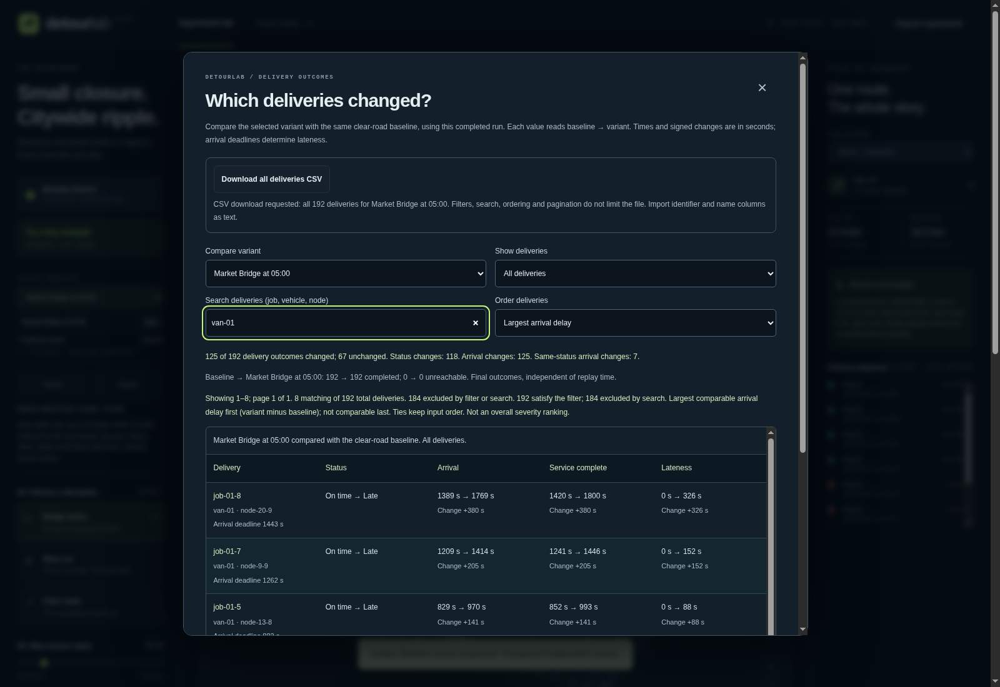
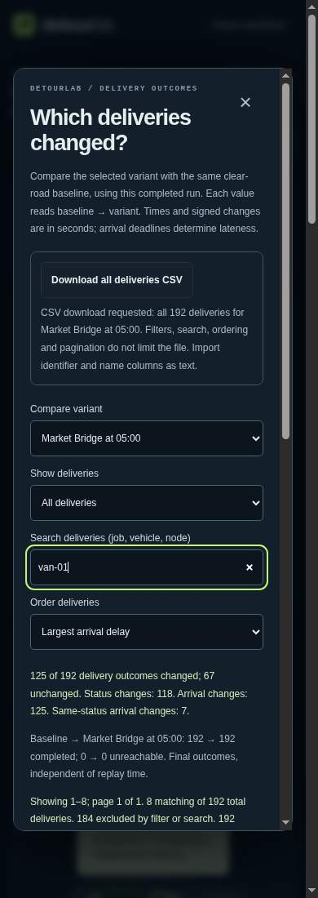

# Find deliveries without losing the complete comparison

After a completed run, open **Inspect deliveries**, choose a variant and filter,
then search by job, vehicle or destination node ID. This source feature reuses
completed results: it does not rerun routing, edit the experiment or upload data.
The hosted demo remains the separately recorded v11 release.

## Search and order

- Search is a trimmed, case-insensitive literal substring of any of the three
  IDs. It is not a regular expression, fuzzy search or a search of timing cells.
- The selected outcome filter is applied first. Counts distinguish those rows
  from search matches and the complete experiment. Clear the query or choose
  **All deliveries** when an expected delivery is outside the current view.
- **Input order** is the default. **Largest arrival delay** sorts comparable
  arrival changes, variant minus baseline, from largest to smallest. Negative
  values remain negative; ties keep original input order. Incomparable changes
  remain last, never treated as zero.
- This is not an overall severity score. An unreachable delivery may matter more
  than a timed delay, despite appearing last in this particular ordering. The
  complete status summary and explicit non-comparable labels remain visible.
- At most 20 rows are rendered. Search, filter, ordering and variant changes
  reset the page. Variant changes retain the query and ordering; closing and
  reopening starts again with changed outcomes, no query and input order.

For the bundled Meridian experiment, select `market-05`, choose all deliveries
and search `job-01-4`. Its arrival changes from 690 to 741 seconds (+51), even
though both outcomes remain on time. Searching a vehicle ID finds its assigned
jobs; searching a node ID finds deliveries to that destination.

**Download all deliveries CSV** always exports the selected variant's complete
comparison in original input order. No search, filter, sort or page truncates
the file. See [CSV format and import precautions](DELIVERY_CSV.md).

## Lifecycle and verification

Search and ordering are local presentation state. Input changes and reruns
invalidate the inspector with the same completed-result guards as before.
Replay time does not change final delivery outcomes. No stored result or source
job order is mutated. This adds no simulation claim or routing optimization.

```sh
node --test tests/browser-impact.test.js tests/browser-impact-ui.test.js
npm run check
node scripts/verify-dist.js
```

Pure tests cover matching, filter intersections, stable numeric ordering,
incomparable values, empty matches and bounded pagination. Application tests
cover resets, variant changes, invalidation and complete CSV independence.
Native Chromium evidence is recorded separately below when verified; DOM
stand-ins alone are not native keyboard, layout or accessibility evidence.

## Product context

The November 7 read of the requested [God’s Eye View reference](https://github.com/bilawalsidhu/gods-eye-view)
reinforces making an interactive scene inspectable. DetourLab’s distinct need
here is finding one delivery or a large comparable delay among up to 2,000
synthetic orders without losing the complete evidence. No reference code, data
or assets were copied; no popularity or adoption outcome is promised.

## Recorded source verification — November 7, 2026

[Source `c0b9505`](https://github.com/Tabisharaza/detourlab/commit/c0b95052370538cbf658ee57192da875f56854fc)
passed [CI run 42349371221](https://github.com/Tabisharaza/detourlab/actions/runs/42349371221).
The [raw query evidence](evidence/delivery-search-2026-11-07.json) is extracted
without field changes from the job's printed JSON. All recorded source and
screenshot SHA-256 hashes were checked against the tested bytes.

- **1,439 distinct Node tests** passed: 1,319 core plus 120 optional schema/editor
  tests. The repeated 211 CLI gates overlap the core tests and are not added.
- All **15 new native-browser checkpoints** passed. Actual search input covered
  ID matching, case folding, literal punctuation and empty results; selected
  filters and variants used DOM events, not human keyboard interaction.
- Full ranked pagination matched separate CLI outcomes, including **57 null**
  comparisons and **69 negative** arrival deltas in the all-bridges fixture.
  Ties retained original order. Native results remained unchanged by queries.
- **Two actual completed CSV downloads** matched separate CLI processes
  byte-for-byte, despite empty or searched/ranked views. Both retained all 192
  jobs in original input order.
- All **101 earlier browser checkpoints** and **four rendering-profile cases**
  passed separately, as did the 32-file release allowlist, source/hash/license
  verification and byte-identical rebuild including its manifest.

The native run used Chromium 156.0.8078.79 on the Ubuntu 24.04 hosted runner,
image `20261101.360.1`, and Node 24.22.1. The local environment's Chromium socket
restriction was not bypassed; this is hosted CI evidence, not a local browser
pass. It does not establish OS chooser, screen-reader, physical mobile device,
spreadsheet-product or cross-browser behavior. The public demo was not deployed.

The unaltered captures below were visually reviewed. Desktop search, order and
ranked rows are readable. At 390 CSS pixels the controls stack without horizontal
clipping; the dialog scrolls vertically and the wide table retains its separate
scroll region. The screenshot shows only the visible viewport, not the entire
comparison. These are synthetic source captures, not a hosted release.




