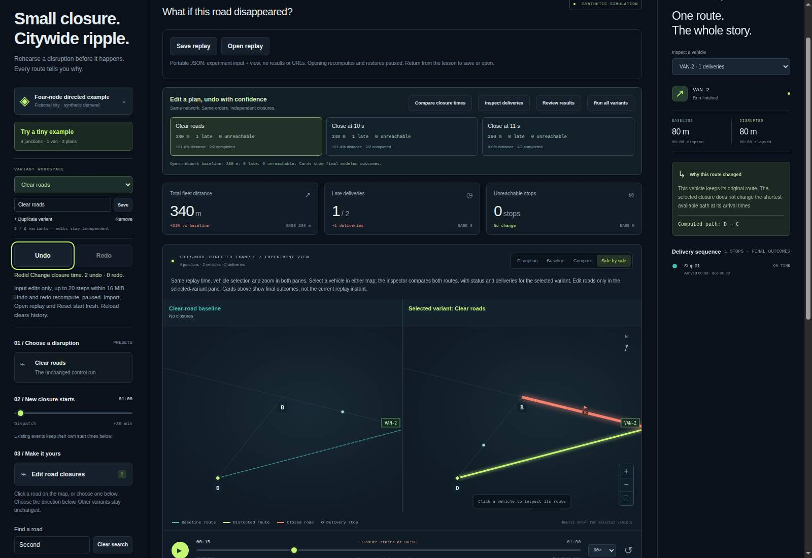
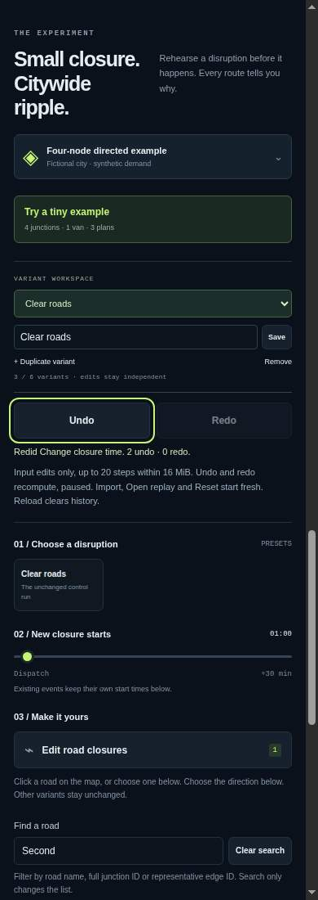

# Recover experiment edits

Undo and Redo make temporary road-closure experiments recoverable within the
current browser session. They restore validated experiment inputs and the
relevant selected variant, then recompute results through the ordinary Worker.
They never restore cached results as evidence.

## Scope and boundaries

History covers committed closure changes, cutoff edits, presets and variant
rename, duplication and deletion. Scrubbing, playback, vehicle selection, map
view, zoom and search are navigation, not experiment edits. Invalid changes and
identical input commits do not add an entry or discard an available redo.
A successful different edit after Undo discards the old redo branch.

The history retains at most 20 undo transitions. Current, undo and redo snapshots
share a 16 MiB serialized UTF-8 payload budget. Oldest undo entries are evicted
when a limit is reached; if only redo entries remain and selection metadata
grows beyond the byte budget, the farthest redo entries are removed first. This bounds the stored snapshot payload, not total
JavaScript heap, simulation results or browser memory. No history is sent to a
server or persisted in local storage. Reloading the page loses session history;
export an experiment or save a replay bookmark for durable handoff.

Successful import, Open replay and Reset begin a new workspace history. Failed
or canceled reads leave the current history intact. Guided lessons disable Undo/Redo and retain the previous workspace’s complete
history, including its redo branch. Returning restores that history; lesson
edits and lesson Reset do not become parent-workspace entries.

Undo/Redo preserves the current view, zoom and road-picker context. Its replay
time is clamped if necessary after the restored result establishes its valid
horizon. Undo/Redo pauses playback and supersedes older computation and pending file or
bookmark navigation. The restored input is recalculated before completed result
views become available. A failed or canceled recomputation does not turn the
previous result into evidence for the restored input.

Use the visible native buttons with pointer or keyboard. This milestone does
not intercept Ctrl/Cmd+Z, so ordinary text and number-field editing retains its
native behavior. Browser automation is not assistive-technology certification.

## Contributor checks

The pure history module is independent of simulation. App regressions cover
history boundaries, interrupted work and focus recovery. The optional native
harness uses synthetic fixtures and a fresh Chromium profile:

```sh
node tools/experiment-history-check/run.js --browser /path/to/chromium --out /tmp/history-evidence
```

Do not overwrite another run's evidence. File injection is separate from OS
chooser behavior, and a source milestone is separate from hosted deployment.

## Design context

Recoverable editing supports DetourLab's existing closure-comparison workflow;
it is not claimed as a novel industry interaction. Read-only comparison with
[God's Eye View](https://github.com/bilawalsidhu/gods-eye-view),
[kepler.gl playback](https://docs.kepler.gl/docs/user-guides/h-playback) and
[ArcGIS Experience Builder](https://doc.arcgis.com/en/experience-builder/11.5/build-apps/save-preview-publish.htm)
favored reliable authoring over another export format or a live-data expansion.
No code or data was copied and no demand or Trending outcome is promised.

A bounded November 4 GitHub Trending snapshot showed mostly AI/developer tooling,
not a relevant logistics comparator. It was not used as evidence of demand.

## Recorded source verification — November 4, 2026

[Source `2c8e0b1`](https://github.com/Tabisharaza/detourlab/commit/2c8e0b17d931af63f023e3bb809b09f0b7bd4631)
passed [CI run 41785797533](https://github.com/Tabisharaza/detourlab/actions/runs/41785797533).
The [unaltered history evidence](evidence/edit-history-2026-11-04.json) records
source/fixture hashes, actual runtime, browser version and all 11 new native
checkpoints.

- 1,226 core Node tests plus 120 optional schema/editor tests passed: **1,346
  distinct tests**. The 211 repeated CLI tests overlap the core suite.
- All 11 history checkpoints passed alongside 21 file/browser, 13 split-map,
  11 bookmark and 13 replay-event checkpoints, plus four render-profile cases.
- The 31-file static release passed independent allowlist, source-byte, license
  and SHA-256 checks; rebuilding reproduced every byte including the manifest.
- Model tests cover exact 16 MiB capacity, 20 retained transitions, multibyte
  payloads, eviction, frozen/forged state, caller mutation and independent
  restored objects. A separate read-only 400-operation reference-model probe
  also passed; that probe is not included in the test count above.

Native checks used real Workers and complete independent Node ledger comparisons,
trusted Enter/Space activation, road/cutoff and variant edits, divergent redo,
terminated pending computation, delayed native file reads, rejected files and
lesson/import/replay/Reset boundaries. The Worker cancellation check observes
termination and replacement results; adversarial delivery after termination is
covered separately by handler stand-ins, not claimed as a native observation.

Review caught and corrected whole-history revalidation on every action before
publication. Only module-issued fully frozen histories receive the identity
fast path. Restoring a target still validates fresh input; externally supplied
history states still undergo complete validation. No parsed graph or computed
result cache is introduced. A pre-existing guided-lesson test also caught a
no-op compatibility change; lessons retain their prior narrative-reset behavior
while remaining excluded from parent history.

Both raw captures were inspected: visible history buttons, keyboard focus,
action status and help text are legible at desktop and 390px CSS viewport widths
without horizontal clipping. They show local synthetic source, **not a hosted
release**. Hosted v11, native OS chooser, device and assistive-technology status
remain separately documented.




