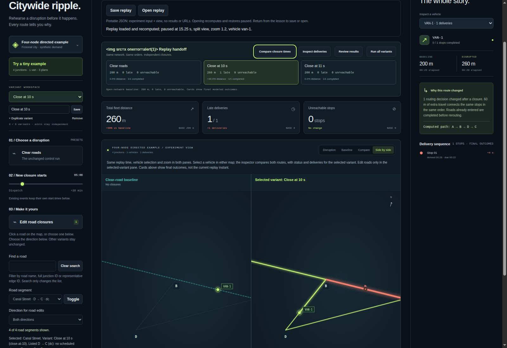

# Portable replay bookmarks

An experiment file preserves the inputs. A replay bookmark also preserves the
specific comparison you want another person to inspect: variant, vehicle,
absolute replay time, map mode and zoom.

## Use the source workbench

1. Run an experiment and choose a variant and vehicle.
2. Pause or scrub to a useful moment; choose **Side by side** if helpful.
3. Choose **Save replay** to request a local JSON download.
4. Use **Open replay** to select that file. The workbench validates its complete
   input, recomputes the experiment, and restores a **paused** perspective.

The download includes the full experiment's supplied network and demand, not
only the visible map. Share only synthetic or otherwise publishable inputs.
No account, remote upload, URL sharing, local storage or result cache is added.
The ordinary experiment import/export format remains unchanged.

Saving is unavailable during a pending/failed/canceled run and during the tiny
lesson. Opening a bookmark is separate from ordinary experiment import. Invalid
files do not replace the current workspace. Later navigation, edits, imports,
Reset or Cancel must not be overwritten by an older pending replay restore.

If a saved time exceeds the recomputed timeline, restoration clamps it to that
timeline and explicitly reports the change. Playback speed, playing state,
road-edit mode, modal contents and prepared reviews are not persisted. Imported
views are paused and road editing is off. A null vehicle means no selection.

## Version 1 contract

```json
{
  "format": "detourlab-replay-bookmark",
  "version": 1,
  "experiment": { "...": "validated experiment v1, with no results" },
  "perspective": {
    "variantId": "close-at-10",
    "vehicleId": "van-1",
    "timeS": 15.5,
    "view": "split",
    "zoom": 1.2
  }
}
```

The excerpt is a shape illustration, **not an importable fixture**. The
[complete synthetic example](examples/tiny-replay.bookmark.json) is importable.

All properties are required and unknown properties are rejected. The variant
must exist in the included experiment; vehicle must be null or an existing
vehicle ID. Map mode is `disruption`, `baseline`, `compare` or `split`. Zoom is
0.65–2.5. Time is finite and nonnegative, at most `Number.MAX_SAFE_INTEGER`;
the final usable range is established by recomputation. Fractional seconds are
preserved even though the familiar clock display rounds down to whole seconds.
UTF-8 file size is capped at 2 MiB, including the view metadata. A maximal input
that fits an experiment file might not fit a bookmark; the app reports that
failure instead of omitting data.

`src/replay-bookmark.js` reuses strict experiment validation and canonical
serialization. Input arrays retain meaningful order. Object prototypes,
accessors, unsupported keys and result-cache fields are rejected. Export is
stable compact JSON. This is not a signed artifact or proof of authorship.

Reopening uses the current engine. A bookmark contains no build identity and
does not promise identical outcomes across changed engine versions. For outcome
verification use the separate [review packet verifier](REVIEW_VERIFICATION.md).

## Checks and limits

Run the normal contributor checks, plus the optional native checker:

```sh
node tools/replay-bookmark-check/run.js --browser /path/to/chromium --out /tmp/replay-evidence
```

The output directory must not already exist. The checker uses a fresh isolated
profile, local synthetic fixtures and unchanged native Workers. Automated file
injection is not OS file-picker certification. Captures are raw screenshots;
their existence alone is not a visual review. Native evidence is recorded only
after a successful run; hosted deployment is a separate gate.

## Verified source evidence — November 2, 2026

[Source c8173cf](https://github.com/Tabisharaza/detourlab/commit/c8173cfb2fe01a9686db1b360a7d54f28f5ccc31)
passed [exact-source CI 41400985719](https://github.com/Tabisharaza/detourlab/actions/runs/41400985719).
The [complete bookmark evidence](evidence/replay-bookmark-2026-11-02.json) is
reconstructed without field changes from that job's printed JSON. It records
Headless Chrome 156.0.8078.47, Node 24.22.1 and Linux x64.

All **11 native bookmark checkpoints** passed: exact fractional perspective,
complete native Worker/Node ledger equality, literal hostile labels, actual
local download, byte-identical downloaded-file reopening/re-export, repeated
loads, keyboard focus, narrow overflow, invalid-reference preservation,
explicit duration clamping, Reset and newer-view supersession of delayed reads.
The first checkpoint combines perspective and ledger checks; these descriptions
are coverage, not additional test counts.

The same CI passed **1,143 core + 120 optional = 1,263 distinct Node tests**,
211 overlapping CLI repetitions, 21 existing browser checkpoints, 13 split-map
checkpoints and four rendering-profile cases. Its **29 release files** and
manifest rebuilt byte-for-byte, and verification left tracked source unchanged.
Core/app stand-ins additionally cover canceled/stale Workers, road-edit and
variant-card navigation, null selections, failed recomputation and lessons.

Actual raw captures were inspected: controls and exact-time status are legible,
the narrow layout has no horizontal overflow, and the HTML-like experiment
name is visible literal text—not executed markup. The map remains at the saved
1.2× zoom; cropped network edges are the saved view, not missing scenario data.
The narrow capture shows the controls and upper workbench, not the entire page.



[Open narrow capture](images/replay-narrow-2026-11-02.jpg). Viewports are
1600×1100 and 390×1100 CSS pixels, DPR 1, mobile emulation off, JPEG quality 65.
Images are unretouched captures after transient notifications dismiss. Hashes
and sizes are recorded in the evidence. These are local CI source captures,
not a new hosted release. The public hosted demo remains v11. OS file chooser,
real-device, assistive-technology and cross-browser checks remain separate.

## Design provenance

The November 2, 2026 read-only comparison of
[God's Eye View](https://github.com/bilawalsidhu/gods-eye-view) and
[kepler.gl's config/data export](https://docs.kepler.gl/docs/user-guides/k-save-and-export)
highlighted the value of preserving a presentation perspective alongside data.
Scene sharing is not a unique invention. DetourLab's scope remains a portable,
deterministic, fixed-sequence synthetic counterfactual—not
[VROOM-style optimization](https://github.com/VROOM-Project/vroom) or live traffic.
No code, assets or data from these projects were copied. Current Trending
observations are not evidence of demand or a promise of traction.
