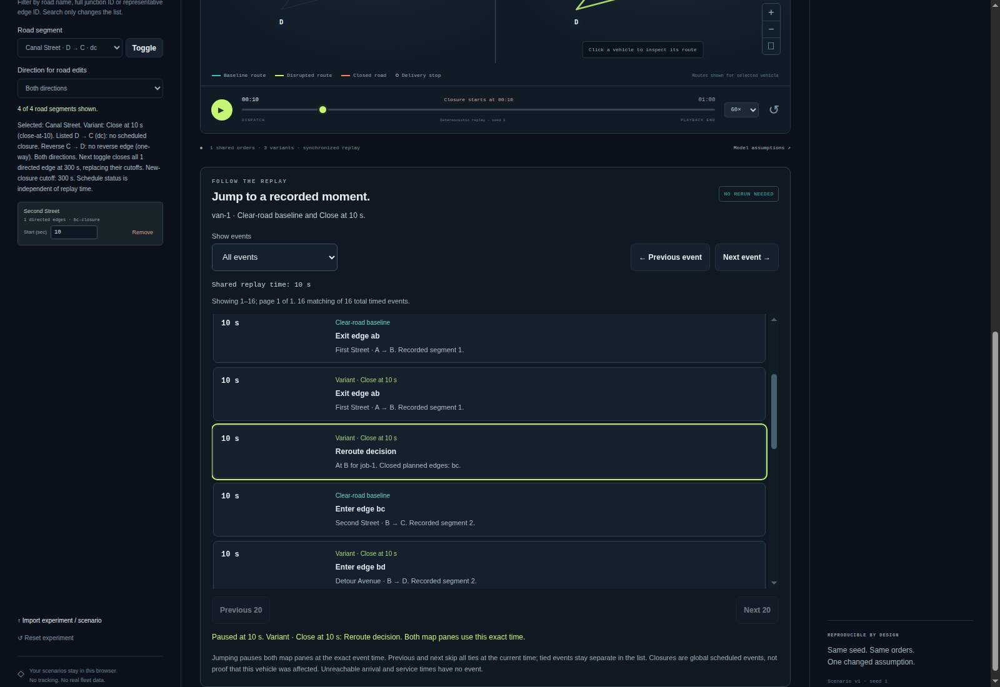
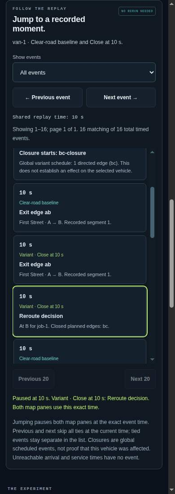

# Inspect exact replay events

The source workbench's replay-event panel connects completed ledger facts to
the map. Select a vehicle, choose an event, and inspect both maps at that exact
absolute time. Then use the existing **Save replay** control to preserve that
perspective for another person.

## What the list means

- **Baseline** events describe the selected vehicle on clear roads.
- **Variant** events describe the same vehicle under the selected schedule.
- **Schedule** events are the selected variant's global closure start times.
  They do not assert that this vehicle used, reached or was affected by that road.

Routing events include recorded segment entry/exit and rerouting decisions.
Delivery events include recorded arrival and service completion. An unreachable
job has no arrival/completion timestamp and does not gain an invented event at
zero. A separately recorded no-route decision may still appear. The final
outcome cards and delivery inspector retain their existing whole-run meanings.

The list preserves simultaneous events and exact fractional seconds. **Previous**
and **Next** move to strictly earlier/later times in the chosen filter. They skip
the current timestamp as a group; all tied events remain available in the list.
Choosing a row pauses playback and updates the shared absolute clock without
changing the selected vehicle, variant, zoom or map mode. It does not rerun the
experiment or alter route decisions.

The shared playback horizon includes scheduled closure starts across all
variants, even when they occur after the last delivery. Switching variants
therefore cannot truncate a saved event time. Extending playback does not
change completed-run durations or delivery metrics.

## Bounded interaction

Filters distinguish deliveries, routing, schedule closures and all events. The
list shows at most 20 rows per page and reports counts. It is rebuilt for a new
completed result, vehicle or variant, not for each animation frame. Pending,
canceled and failed runs clear stale rows. New selections and imports cannot
leave an old row able to jump the new workspace. An event jump also takes
precedence over any pending bookmark perspective restoration.

The existing numeric clock display rounds down to whole seconds; event labels
retain exact numeric seconds. Canvas interpolation uses the actual fractional
time. Keyboard users can use native filter, page and jump controls; this is not
an assertion of completed screen-reader certification.

## Try a hand-checkable comparison

Open the tiny experiment and choose **Close at 10 s**. For `van-1`:

1. At 10 s, the selected closure activates and the variant records a routing
   decision at B. Baseline and variant events remain separately labeled.
2. The baseline arrives at C at 20 s and completes service at 23 s.
3. The variant arrives at C at 26 s and completes service at 29 s.

At a shared timestamp there may be several segment, schedule and decision
events. Their ordering is a stable presentation order, not proof of a causal
sequence beyond the engine's recorded model. No live traffic or optimality
claim is introduced.

## Verification and boundaries

`src/replay-events.js` is a pure projection over existing completed ledgers. It
does not invoke simulation. Model, input, result, review and bookmark
formats remain unchanged. Run the ordinary contributor checks and the optional
native checker with an installed Chromium and a new output directory:

```sh
node tools/replay-events-check/run.js --browser /path/to/chromium --out /tmp/event-evidence
```

The native checker uses a fresh isolated profile and synthetic inputs. Actual
native results and visual captures are recorded separately from Node stand-ins.
File injection does not establish OS chooser behavior. The hosted demo remains
the separately documented v11 release until a deployment is verified.

## Design provenance

A November 3, 2026 read-only comparison of
[God's Eye View](https://github.com/bilawalsidhu/gods-eye-view),
[kepler.gl playback](https://docs.kepler.gl/docs/user-guides/h-playback) and
[VROOM](https://github.com/VROOM-Project/vroom) reinforced the usefulness of
inspectable time/evidence without changing this fixed-order synthetic model
into a live-data platform or optimizer. No code or data was copied. Current
GitHub Trending observations are not evidence of demand or promised traction.

## Recorded source verification — November 3, 2026

[Source `7f6e6d4`](https://github.com/Tabisharaza/detourlab/commit/7f6e6d4ff08e199def0a8d206b7c9581f23f3343)
passed [CI run 41589694093](https://github.com/Tabisharaza/detourlab/actions/runs/41589694093)
on Node 24.22.1 and headless Chrome 156.0.8078.47:

- 1,183 core Node tests and 120 optional schema/editor tests passed: **1,303
  distinct tests**. The separately repeated 211 CLI tests overlap the core suite.
- All 13 new native event checkpoints passed, alongside the existing 21 browser,
  13 split-map and 11 bookmark checkpoints and four rendering-profile cases.
- The 30-file static release passed the independent allowlist/source/hash check;
  a second build reproduced every byte, including the manifest.
- A Node fixture generated 500,000 actual result segments across the experiment.
  Its selected comparison contained 1,008,000 indexed events and 50,400 pages,
  each bounded to 20 display records. This is a correctness/bounded-allocation
  check, not a native responsiveness benchmark or maximum-device guarantee.

The [unaltered native evidence](evidence/replay-events-2026-11-03.json) records
source hashes, runtime, fixture hashes and actual checks. It includes trusted
native Enter/Space row activation, exact 29.375-second download/reopen and a
123.375-second scheduled closure after the 60-second engine horizon. The first
staging attempt failed because the test harness omitted Enter's CDP activation
text; the corrected harness retains the exact-time assertions and also requires
trusted keyboard-generated clicks. No app behavior was changed to pass that test.

The raw captures below were inspected at desktop and 390px CSS viewport widths:
the panel, native controls, source labels, focused reroute row and explanatory
text are legible without horizontal clipping. The list is intentionally scrolled
around the selected event, so partial neighboring rows show its scroll boundary.
This is bounded local-source evidence, **not a hosted deployment** or certification
of native mobile devices, OS file choosers or assistive technology.




