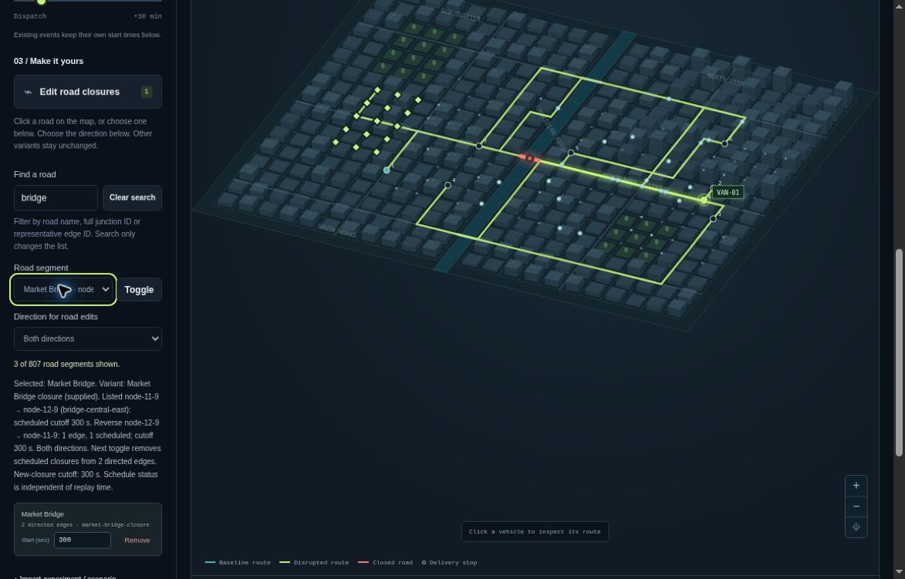

# Searchable road editing

## Release status

The searchable picker and lifecycle-focus correction are deployed in public
demo **v10**. The [dated v9 desktop Chromium observations](VERIFICATION.md#v9-road-picker-deployment-and-bounded-desktop-checks)
cover specific search, keyboard, lesson and 200% desktop-zoom flows. That review
exposed a pre-existing run-lifecycle focus defect. The correction passes source tests and independent review and is
[deployed in v10](VERIFICATION.md#v10-run-lifecycle-focus-deployment). Its native
cancellation/completion focus retest and served-manifest check passed. Public
GitHub source identity and exact-commit CI remain pending.
The implementation is based on public source
`25c7fb636c6151d5a9e1b7ddcd5cf8c7e8ab349d`.

## Workflow

The seed-42 demo has 432 junctions and 1,614 directed edges, represented by 807
road-pair choices. **Find a road** filters the existing native **Road segment**
selector. The browser's ordinary select is retained rather than replaced by a
custom combobox.

1. Select the experiment variant to edit.
2. Search for a road name, a full endpoint ID or a representative edge ID.
3. Choose the road and direction. Read the context for the selected variant's
   saved closure schedule.
4. Set the cutoff and activate **Toggle**. Other variants keep their independent
   schedules.
5. Use **Clear search** to restore all road choices.

Filtering does not launch a simulation or edit the experiment. A still-matching
selection is retained; otherwise the first visible choice is selected. Zero
results disable the selector and edit action. The explanation distinguishes no
matching roads from a graph with no road segments. No results are truncated.

Matching is a case-insensitive substring search with outer whitespace trimmed.
It does not remove accents, rank results or change the existing road order. It
searches each pair's representative name, full endpoint IDs and representative
edge ID; it does not add aliases for every parallel or reverse edge.

Ordinary closure edits and variant changes keep the search. A successful import
or Reset starts with all choices. Entering or resetting the optional lesson
starts a fresh search; returning restores the earlier experiment's search and
selection. Failed or superseded imports preserve the current view state.



*Unaltered public v10 screenshot, approximately 08:47 UTC on October 19, 2026:
1173×751 pixels, desktop Chromium on Linux, 100% zoom.
[Provenance and verification scope](VERIFICATION.md#v10-native-focus-checks-and-screenshot).*

## Keyboard and feedback design

The search input and native selectors have explicit labels. The short result
count is a polite status message; unchanged count text is not reassigned. The
longer selected-road explanation is static text associated with the road,
direction and edit controls. These source properties do not establish what a
screen reader announces or how often it announces it.

Surviving controls and unchanged option lists retain their identity. When
removing the last closure requires a focus fallback, it uses the road selector
if available or the enabled search field when the selector has no choices. See
[the keyboard guide](KEYBOARD.md) for shared modal and dynamic-editor behavior.
The v9 record names the native popup, keyboard and visible-focus transitions
actually observed. Assistive technology and unexercised transitions remain
separate checks.

## Model boundaries

Road grouping and direction-aware toggle semantics are unchanged. The picker
does not redefine road identity or parallel-edge grouping. Imported labels are
rendered as inert text.

The context describes a **saved schedule**, not whether the road is closed at
the current replay timestamp. Removing a scheduled closure is not a future
reopening event: the engine still models permanent closures from their cutoff.
The fixed vehicle assignments, delivery order and assumed travel times are
unchanged. Search is not fuzzy matching, route optimization or a map search
service.

## Source-level verification

Local checks on **October 19, 2026**, using **Node 24.19.0 / npm 11.9.0 / Linux**,
passed:

- **601 core tests**, including **29 road-picker tests** and **nine new
  run-lifecycle focus regressions**, with no failures or
  skips.
- **120 optional schema/editor tests**, with no failures or skips: **721 distinct
  tests** across those two suites.
- **113 separately repeated CLI tests**, already included in the core total.
- **60 core JavaScript syntax checks** and **two optional `.mjs` syntax checks**.
- Verification of **20 distribution payloads plus manifest**, matching the
  corrected source; the second build was byte-identical, including the manifest.

The new regressions use the checked-in application's actual handlers with the
repository's DOM/Worker stand-ins. Independent review passed 95 focused tests,
11 supplemental probes and 72 baseline pair-toggle comparison assertions.
These overlapping checks are not added to the 721-test total. Initial review
resolved retained old options after a zero-edge import and redundant assignment
of unchanged live-count text. After the lifecycle correction, independent review
passed **25 dynamic-focus tests** and **five terminal-path probes**, with no
unresolved findings in that source scope.

```sh
node --test tests/road-picker.test.js
npm run check
npm run verify --prefix tools/schema-check
node scripts/verify-dist.js
```

The optional checker requires its separately locked dependencies; see [CI.md](CI.md)
for installation and the complete repeat-build sequence. Core startup and checks
remain dependency-free.

Passing stand-in tests does not establish native select behavior, spoken
announcements, visual layout, browser Worker integration, file-chooser behavior
or downloads. A baseline CI result does not verify a later candidate commit.

## Run-lifecycle focus correction

In v9, hiding a focused **Cancel run** control on cancellation or completion
could leave focus on the page. The source deployed in v10 first hands focus to
**Run all variants** if Cancel still owns it, then hides Cancel. It leaves newer
control or modal focus alone, and stale terminal callbacks cannot take focus
from a newer run. Source tests cover cancellation, completion, returned errors,
Worker failures, timeout and construction failure. In the [v10 native
retest](VERIFICATION.md#v10-native-focus-checks-and-screenshot), explicit keyboard
cancellation and normal Worker completion both returned focus to Run all
variants while preserving the road query and selection. Error/timeout paths,
stale callbacks and newer-modal focus remain source-test evidence.

## Browser review and remaining gates

A release record must name the tested source/package, real browser and available
version/platform information, viewport, test date and exact observed outcomes.
Use synthetic fixtures only. Keep unperformed and blocked checks separate from
passed checks.

- Search, choose a road, change direction/cutoff and edit the intended variant
  using native keyboard controls. Record arrows, type-ahead, Tab/Shift+Tab and
  visible-focus observations separately.
- Check no matches and Clear search. Repeat edits, remove events and change
  variants while focused in the affected controls.
- Enter, cancel, reset and return from the tiny lesson. Distinguish restoration
  of search/selection from simulation results.
- Record actual Worker-backed results for the built-in fixtures. Browser
  interaction with those fixtures does not verify native file import/export.
- Check duplicate/long/hostile labels, one-way roads and no-edge input with a documented synthetic fixture-loading route. Source-harness coverage is not
  a substitute for browser coverage of these cases.
- Record narrow/wide layout and zoom only when actually exercised. A narrow
  desktop viewport is not a native mobile-device test.
- Keep screen-reader announcements, reduced-motion behavior and broader
  browser/platform coverage open unless they are tested explicitly.
- Native file selection/download roundtrips, console auditing and browser
  profiling remain unverified.

Capture only genuine, synthetic-data screenshots, with source/version mapping,
size and SHA-256. Deployment evidence and browser observations are separate:
retain the prior Site version for rollback, verify the saved version and deployment
receipt, and do not treat a successful save as proof of CDN-served asset bytes.
Final source publication and CI must name the exact commit after all changes.

See [VERIFICATION.md](VERIFICATION.md) for the dated evidence record. No broad
WCAG, screen-reader, mobile, cross-browser or performance claim is made.

## Design references

- [W3C: labeling form controls](https://www.w3.org/WAI/tutorials/forms/labels/)
  supports visible, explicitly associated labels.
- [MDN: native select](https://developer.mozilla.org/en-US/docs/Web/HTML/Reference/Elements/select)
  describes the platform control retained here.
- [W3C: status messages](https://www.w3.org/WAI/WCAG22/Understanding/status-messages.html)
  distinguishes concise result feedback from unnecessarily chatty live regions.
- [God's Eye View, inspected source](https://github.com/bilawalsidhu/gods-eye-view/blob/93ea088f4556a5a65b3292a2d15142d5a6c562bc/README.md)
  provided product context about finding and inspecting existing scene information.
  No third-party code, datasets or interface assets were copied.
