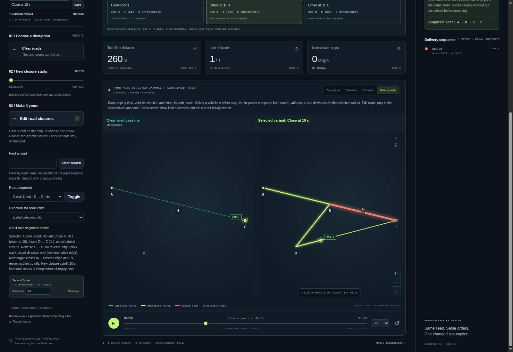

# Synchronized side-by-side replay

Choose **Side by side** above the map to show the **Clear-road baseline** and
**Selected variant** simultaneously. This is an optional source feature; the
hosted demo is not automatically redeployed by a GitHub commit.

Both panes read the same existing experiment, completed results, absolute replay
time, vehicle selection and zoom. They have equal canvas dimensions at wide
layouts and stack at viewport widths of 1,000 CSS pixels or less. No second
simulation runs when opening or switching views. **Compare** retains its original
overlaid routes and ghost vehicles; **Disruption** and **Baseline** remain available.

## Trace the difference

1. Open the tiny example and choose **Close at 10 s**.
2. Choose **Side by side**, then scrub the shared timeline to 15 seconds.
3. The baseline van is on B → C while the selected variant takes B → D.
   Their computed final arrivals remain 20 and 26 seconds respectively.
4. Click a vehicle in either pane, or use the native vehicle selector. Selection
   is shared; the existing inspector compares the two routes and describes the
   selected variant's delivery outcomes, not a separate baseline-only inspector.
5. Use the existing zoom buttons for both panes. Change the variant without
   changing the clock. A vehicle whose route has finished stays at its endpoint.

The cards above the map show final modeled outcomes, not outcomes at the current
replay instant. The baseline pane hides closures and is read-only. Road edits in
the selected-variant pane retain the existing direction/cutoff rules and trigger
the usual full experiment recomputation. Neither map is real traffic or a routing
optimization result.

## Lifecycle and implementation

The existing primary renderer treats split mode as the selected-variant view.
The secondary renderer is constructed lazily and reads a stable read-only state
view that overrides only baseline display and road editing. Results are never
copied into a separate playback state. Null/pending/canceled results therefore
clear both panes, and existing stale Worker/file guards remain authoritative.

Both canvases retain the existing paused-frame guard. The hidden secondary pane
is not rendered. Layout transitions resize/invalidate both scenes and clear old
hit targets before repaint; native resize also clears old hit geometry and the
hover tooltip. Long imported variant labels are rendered as literal text, with
ellipsis and a full title, never HTML. The native variant selector and existing
textual result/route controls remain the keyboard-accessible alternatives to
canvas interaction. No new external assets, dependencies, persistence or network
calls are introduced.

## Evidence and limits

`tests/split-view.test.js` exercises opt-in/lazy construction, repeat toggles,
unchanged inputs/results/Worker count, shared time/zoom/selection, baseline
read-only behavior, canceled and stale results, import replacement, literal
labels, tiny-lesson return, actual renderer hit geometry and paused/hidden paints
using explicit DOM/Worker/Canvas stand-ins. These are not browser pixels or
screen-reader tests.

The dependency-free native checker can be run against an installed Chromium:

```sh
node tools/split-view-check/run.js --browser /path/to/chromium --out /tmp/split-evidence
```

The output directory must not exist. It creates a fresh browser profile and
loopback server, records real Worker results and renderer observations, then
writes `evidence.json` and raw desktop/narrow JPEG captures. CI also records this
bounded synthetic evidence in its job log. The checker waits for transient
notifications to dismiss before capture; it does not retouch the images.

Initial staging [CI 41281292335](https://github.com/Tabisharaza/detourlab/actions/runs/41281292335)
passed all 13 native split checkpoints in Chromium 156.0.8078.47 on Linux.
Visual inspection of those captures found a selected vehicle label clipped at
the right edge of the baseline pane. The follow-up renderer change positions
labels within the canvas and truncates long IDs; the native selector retains
full IDs. Final source evidence and screenshots are recorded below. Subsequent
staging exposed two native-check lifecycle races: readiness before the HTML
element exists and temporary-profile deletion while browser descendants finish
shutdown. The harness now waits for the explicit ready marker and uses bounded
filesystem retries on its own temporary directory. Persistent cleanup failures
still fail the run and evidence; no browser safety flags or assertions are disabled.

These bounded checks are not mobile-device, cross-browser, screen-reader or
native file-chooser certification. Source publication and exact-commit CI are
separate from the unchanged hosted demo.

## Verified source and captures — November 1, 2026

[Staging source `9af4196`](https://github.com/Tabisharaza/detourlab/commit/9af4196d14fb3d6f07f690478d705621ea976a59)
passed [CI 41281972231](https://github.com/Tabisharaza/detourlab/actions/runs/41281972231).
The [complete split evidence](evidence/split-view-2026-11-01.json) is reconstructed
without field changes from that job's printed JSON. It records Node 24.22.1,
Headless Chrome 156.0.8078.47 and Linux x64. All 13 checkpoints passed: native
Worker/Node ledger equality, shared replay/zoom/selection, read-only baseline,
no extra Worker on toggles, hidden-pane suppression, responsive geometry,
literal long labels, pointer selection, lesson restore and canceled/stale reads.

The same run passed **1,111 core + 120 optional = 1,231 distinct Node tests**,
211 overlapping CLI repetitions, 21 separate browser integration checkpoints,
four separate render-profile cases, byte-identical rebuild of 28 release files
plus manifest, and unchanged tracked source. These are different kinds of checks,
not one combined test count.

Actual raw CI captures were visually inspected after download: baseline vehicle
labels now fit, pane headings and routes are legible, desktop panes align, narrow
panes stack, and neither capture has a toast covering replay controls. This is
bounded visual inspection, not assistive-technology or real-device testing.



[Open the narrow capture](images/split-narrow-2026-11-01.jpg).
The desktop viewport was 1600×1100 CSS pixels and the narrow viewport 390×1100,
both DPR 1 with mobile emulation **off**. JPEG quality 65; no retouching or crop.
The tiny synthetic example is paused at 20 seconds with **Close at 10 s** selected.
Capture SHA-256 hashes and byte sizes are in the evidence. These are local CI
source screenshots, **not screenshots of a new hosted release**. The public
hosted demo remains the separately recorded v11 release.

## Design provenance

DetourLab's own roadmap identified synchronized comparison as a useful next
contribution. A November 1, 2026 read-only comparison of
[God's Eye View](https://github.com/bilawalsidhu/gods-eye-view),
[kepler.gl](https://github.com/keplergl/kepler.gl) and
[VROOM](https://github.com/VROOM-Project/vroom) reinforced the distinction between
live/geospatial exploration, route optimization and this fixed-demand,
reproducible synthetic counterfactual workbench. The implementation reuses only
DetourLab's original renderer; no code, map data or assets were copied from these
projects. Current GitHub Trending observations are not evidence of market demand
or a promise of traction.
